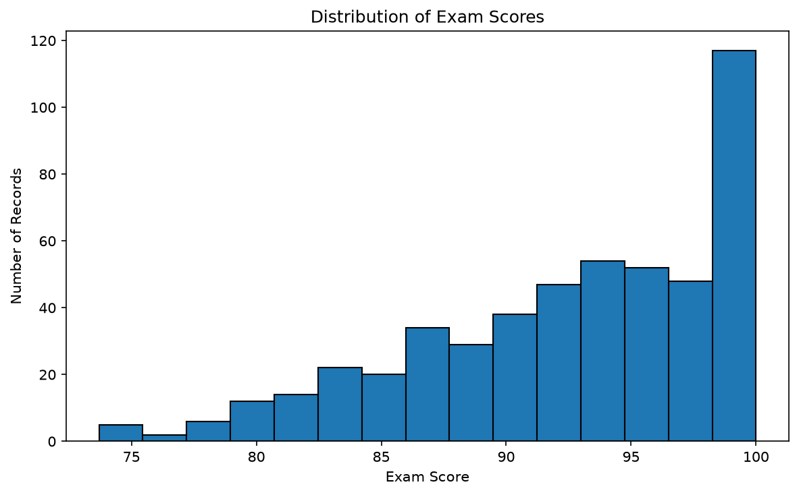
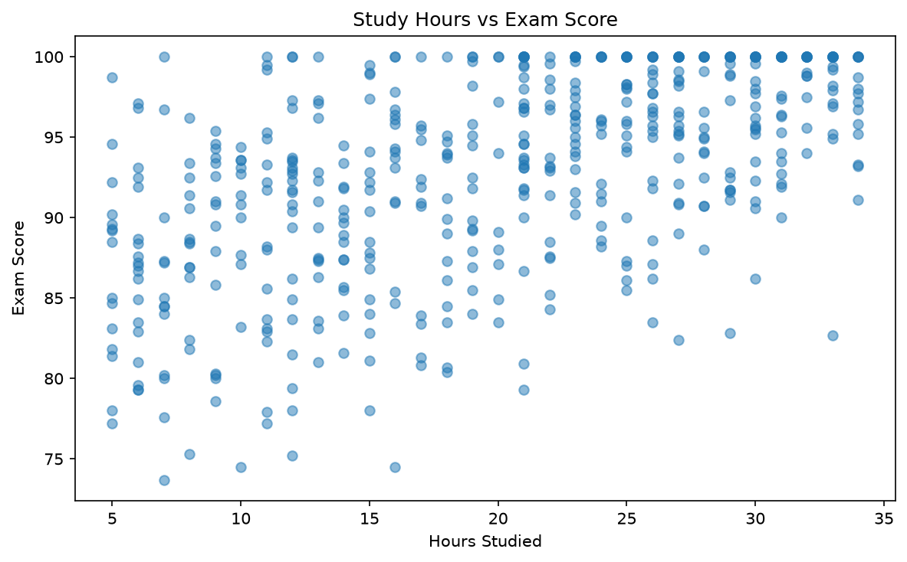
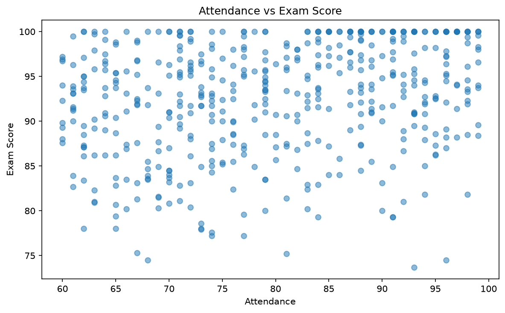
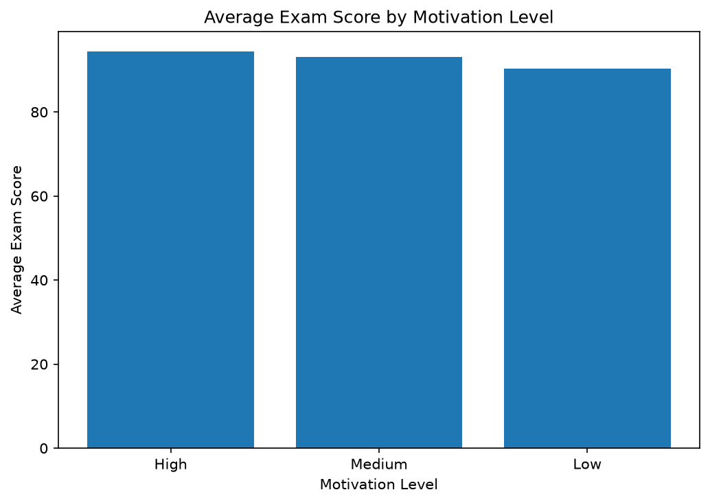
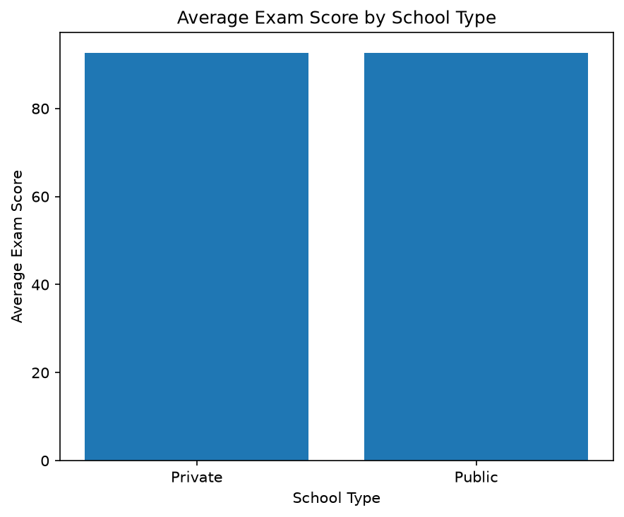
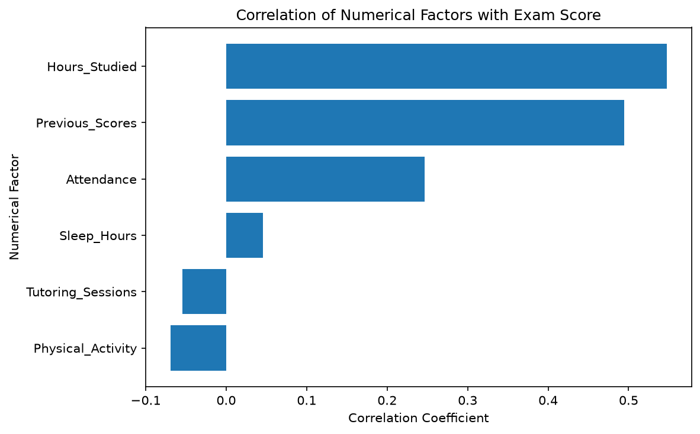

# Student Result Analysis

A Python data-analysis project exploring factors associated with student exam scores. It uses pandas to inspect and clean CSV data, calculates summary statistics and grouped averages, and creates six charts with Matplotlib. Each chart is saved as a PNG in the project folder and also displayed when the script runs.

## Project contents

| File or folder | Purpose |
| --- | --- |
| `Student_Result_Analysis_Using_Your_CSV.py` | Loads, analyzes, and cleans the input data, then generates the charts. |
| `StudentPerformanceFactors.csv` | Input dataset used by the analysis. |
| `StudentPerformanceFactors_Cleaned.csv` | Cleaned dataset generated by the script; the included copy is an example output. |
| `*.png` | Chart images generated by the script and included in this repository. |
| `requirements.txt` | Python package dependencies. |

The datasets contain no student-name column. The script also drops `Student_Name` from the input if that column is present.

## Requirements

- Python 3.10 or later
- pandas
- matplotlib

## Setup and run

Open PowerShell in the project folder. (In VS Code, choose **Terminal → New Terminal** while the project folder is open.)

Optionally create and activate a virtual environment:

```powershell
python -m venv .venv
.\.venv\Scripts\Activate.ps1
```

Install the required packages:

```powershell
python -m pip install -r requirements.txt
```

Run the analysis:

```powershell
python Student_Result_Analysis_Using_Your_CSV.py
```

The script expects `StudentPerformanceFactors.csv` in the project folder. It prints dataset details and analysis summaries, overwrites `StudentPerformanceFactors_Cleaned.csv`, saves the charts as PNG files in the project folder, and opens each chart in a Matplotlib window. Close each chart window to continue to the next one.

If Python reports `No module named 'matplotlib'` or `No module named 'pandas'`, activate the project virtual environment and install the packages using the same Python interpreter that runs the script.

## Analysis steps

1. Loads the CSV and omits the `Student_Name` column, if present.
2. Prints a preview, row/column counts, column names, data types, and missing-value counts.
3. Fills missing numeric values with each column's median and missing text/category values with each column's most frequent value.
4. Removes duplicate rows and writes the cleaned data to `StudentPerformanceFactors_Cleaned.csv`.
5. Summarizes exam scores and reports the average, highest, and lowest scores, along with study hours, attendance, and previous scores for the highest-scoring record.
6. Calculates mean exam scores by parental involvement, access to resources, motivation level, internet access, school type, peer influence, and gender.
7. Counts records with an exam score of 80 or above and prints a sample of those records.
8. Calculates correlations between numeric columns and `Exam_Score`.

## Generated charts

The following charts are saved in the project folder each time the script runs:

1. `exam_score_distribution.png` — distribution of exam scores.
2. `study_hours_vs_exam_score.png` — study hours compared with exam scores.
3. `attendance_vs_exam_score.png` — attendance compared with exam scores.
4. `average_exam_score_by_motivation.png` — average score grouped by motivation level.
5. `average_exam_score_by_school_type.png` — average score grouped by school type.
6. `correlation_with_exam_score.png` — correlation of numeric factors with exam score.

### Exam score distribution



### Study hours and exam score



### Attendance and exam score



### Average score by motivation



### Average score by school type



### Correlation with exam score



## Notes on interpretation

These summaries and visualizations describe patterns in the provided dataset. A correlation or group-average difference does not establish that one factor causes a change in exam performance. The score threshold of 80 is an example used by the script and can be changed in the source.
